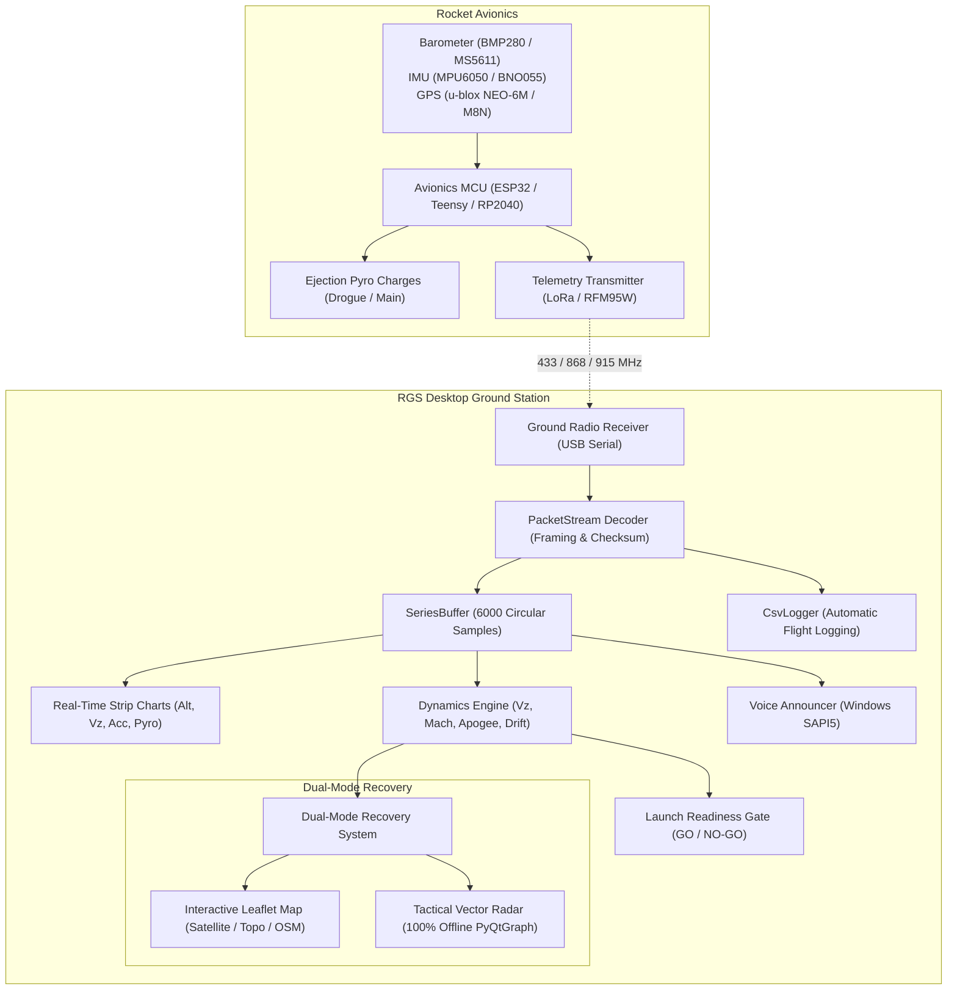

# 🚀 Rocket Ground Station (RGS)

[](https://www.python.org/downloads/)
[](https://riverbankcomputing.com/software/pyqt/)
[](https://www.pyqtgraph.org/)
[](LICENSE)
[](https://microsoft.com/windows)

**Rocket Ground Station (RGS)** is a high-performance, real-time desktop telemetry and recovery tracking application designed for amateur and high-power rocketry. Built with **PyQt6**, **PyQtGraph**, and **Leaflet.js**, it decodes 20 Hz binary telemetry packets over serial radio links (LoRa, RFM95W, HC-12, ESP32, XBee), plots real-time strip charts at 60 FPS, computes flight dynamics and landing predictions, provides voice audio callouts, and features a dual-mode GPS recovery interface that functions **100% offline** at remote launch sites.

---

## 📑 Table of Contents

- [System Architecture](#system-architecture)
- [Key Features](#key-features)
- [Hardware & Binary Packet Protocol](#hardware--binary-packet-protocol)
- [Installation & Prerequisites](#installation--prerequisites)
- [Quick Start Guide](#quick-start-guide)
- [User Interface Overview](#user-interface-overview)
- [Dual-Mode Recovery Map & Radar](#dual-mode-recovery-map--radar)
- [Pre-Flight Launch Readiness Gate](#pre-flight-launch-readiness-gate)
- [Flight Safety & Pyrotechnic Testing](#flight-safety--pyrotechnic-testing)
- [100% Offline Field Launch Setup](#100-offline-field-launch-setup)
- [Compiling to Standalone Executable (.exe)](#compiling-to-standalone-executable-exe)
- [Firmware Integration (Arduino / C++)](#firmware-integration-arduino--c)
- [Keyboard Shortcuts & CLI Arguments](#keyboard-shortcuts--cli-arguments)

---

## 🏛️ System Architecture



---

## ✨ Key Features

- **High-Rate Binary Telemetry Link**: Decodes 20 Hz binary telemetry packets with XOR-0xAA checksum verification and automatic corrupted packet rejection.
- **Ultra-Smooth 60 FPS Charts**: Low-latency PyQtGraph strip charts with anti-twitch stable auto-ranging, inspect-on-hover cursor, and flight state vertical line demarcations.
- **Automated Flight Dynamics**:
  - Vertical Velocity ($V_z$) with backward-difference and smoothing.
  - Mach number and speed-of-sound computation based on standard atmosphere temperature lapse.
  - Real-time filtered apogee latch and ballistic apogee prediction ($h_{pred} = h + \frac{V_z^2}{2g}$).
  - Descent health monitoring (detects ballistic freefall vs nominal parachute descent).
- **Dual-Mode Recovery Map**:
  - **Interactive Web Map**: Leaflet.js engine with zero API key dependencies. Layers: Keyless Aerospace Dark, Esri World Imagery (Satellite), Esri Topographic, OpenStreetMap Standard, and Local Offline Tile Packs.
  - **Tactical Vector Radar (100% Offline)**: Native PyQtGraph display with metric concentric range rings (50 m, 100 m, 250 m, 500 m, 1 km, 2 km, 5 km), compass crosshairs with cardinal headings, line-of-sight vector, and touchdown prediction zone.
  - **Live Recovery Telemetry**: Continuous downrange distance, compass azimuth bearing (0-360° and cardinal directions), slant range, and elevation angle.
- **Pre-Flight Launch Readiness Gate**: Continuous multi-variable gate evaluating serial data link rate (>= 5 Hz), GPS lock (>= 4 satellites), pad coordinate latching, and pyrotechnic continuity. Displays clear visual `GO` / `NO-GO` status.
- **Audio Voice Announcer**: Local Windows SAPI5 text-to-speech engine (`pyttsx3`) running in a daemon thread. Announces liftoff, burnout, apogee, parachute deployment, descent warnings, and touchdown with zero cloud/internet latency.
- **Safety Pad-Locks & Remote Testing**:
  - Timed lockout guards and confirmation prompts.
  - **Test Drogue**: Emits `test_drogue`
  - **Test Main**: Emits `test_main`
  - **Test Barometric Sensor**: Emits `test_baro`
  - Arbitrary manual serial command line.
- **Black-Box Flight Logging & Replay**:
  - Saves flight records to `./telemetry_logs/flight_YYYYMMDD_HHMMSS.csv` with per-sample flush to withstand laptop crashes.
  - Full flight replay engine with adjustable speeds (`0.5x`, `1.0x`, `2.0x`, `5.0x`, `10.0x`) for post-flight debriefs.
- **Daylight & Dark Theme Switching**: Instant toggle between Dark Aerospace (low-glare) and Sunlight-Readable Light mode (outdoor launch fields).
- **Single-File Executable Packaging**: Fully optimized for packaging with PyInstaller into a standalone `RocketGroundStation.exe`.

---

## 📡 Hardware & Binary Packet Protocol

### Binary Packet Framing (28 Bytes)

Each telemetry frame begins with a 2-byte sync header `0xAA 0x55` followed by 25 payload bytes and a 1-byte XOR checksum:

| Offset | Field | Type | Description |
|:---:|:---|:---:|:---|
| `0..1` | **Header** | `uint8[2]` | Sync word: `0xAA 0x55` |
| `2..5` | **Timestamp** | `uint32_t` | Flight computer uptime in milliseconds (`t_ms`) |
| `6` | **Flight State** | `uint8_t` | `0`=Pad, `1`=Boost, `2`=Coast, `3`=Drogue, `4`=Main, `5`=Landed |
| `7..10` | **Acceleration** | `float32` | Vertical acceleration in $m/s^2$ (gravity-compensated) |
| `11..14`| **Altitude** | `float32` | Barometric altitude in meters above ground level (AGL) |
| `15..18`| **Latitude** | `float32` or `float64` | GPS Latitude in decimal degrees |
| `19..22`| **Longitude** | `float32` or `float64`| GPS Longitude in decimal degrees |
| `23` | **Satellites** | `uint8_t` | Number of tracked GPS satellites (`>= 4` for 3D fix) |
| `24` | **Continuity** | `uint8_t` | Bit 0: Drogue pyro continuity, Bit 1: Main pyro continuity |
| `25` | **Checksum** | `uint8_t` | Running XOR of all 25 payload bytes XOR `0xAA` |

The stream decoder automatically parses raw ASCII debug text emitted by the flight computer and displays it in the Flight Event Log tab.

---

## 💻 Installation & Prerequisites

### 1. Python Environment
RGS requires **Python 3.10, 3.11, 3.12, or 3.13** on Windows, macOS, or Linux.

### 2. Install Dependencies
Open PowerShell or your command prompt:

```powershell
pip install PyQt6 pyqtgraph numpy pyserial
```

#### Optional Recommended Packages:
```powershell
pip install PyQt6-WebEngine folium pyttsx3
```
- `PyQt6-WebEngine`: Enables the interactive Leaflet web map with satellite imagery. *(If omitted, RGS automatically runs in Tactical Vector Radar mode).*
- `folium`: Enables standalone HTML interactive map export.
- `pyttsx3`: Enables audio voice announcer callouts using local Windows SAPI5.

---

## 🚀 Quick Start Guide

### Running with Real Hardware
Connect your ground station radio receiver (USB serial) to your computer:

```powershell
python gui.py
```
1. Select your receiver COM port from the dropdown menu (e.g. `COM4`).
2. Click **Connect**.
3. RGS begins logging and charting telemetry immediately upon packet arrival.

### Running in Simulated Demo Mode
Test the complete application, simulated liftoff, apogee, dual ejection, and landing without hardware:

```powershell
python gui.py --demo
```

### Running with Recorded Flight Replay
Replay a previous flight CSV at real-time or accelerated speed:

```powershell
python gui.py --replay telemetry_logs/flight_20261101_120000.csv
```

### Running in High-Contrast Sunlight Mode
```powershell
python gui.py --light
```

---

## 🖥️ User Interface Overview

```
+----------------------------------------------------------------------------------------------------+
| [Logo] ROCKET GROUND STATION    Port: [COM4 v] [Refresh] [Baud: 115200 v] [ CONNECT ] [Replay...]  |
|                                 [🔊 Voice: ON]  [Theme: ☀️ / 🌙]                                    |
+----------------------------------------------------------------------------------------------------+
| CARDS: [STATE: BOOST] [ALT: 450 m] [Vz: +85 m/s] [MACH: 0.25] [APOGEE: 850 m] [GATE: GO]          |
|        [GPS: 14.5995, 120.9842 | 9 Sats] [ACCEL: 45.2 m/s²] [DROGUE: OK] [MAIN: OK]                |
+---------------------------------------------------+------------------------------------------------+
| LIVE STRIP CHARTS (PyQtGraph 60 FPS)              | DUAL-MODE RECOVERY MAP / TACTICAL RADAR        |
| - Altitude AGL (m) & Apogee Markers               | - [🎯 Vector Radar (Offline)] / [🗺️ Web Map]    |
| - Vertical Velocity (m/s) & Mach Thresholds       | - Auto-Follow | Fit Track | Rocket | Latch Pad |
| - Acceleration (m/s² / G-force)                   | - Concentric Metric Range Rings (50m - 5km)    |
| - Pyrotechnic Continuity Status                   | - Predicted Touchdown Ellipse & Drift Vector   |
|                                                   | - Recovery Readout: Downrange, Bearing, Elev   |
+---------------------------------------------------+------------------------------------------------+
| TABS: [Flight Event Log]  [Serial Monitor (RX/TX)]  [Pad Safety & Pyrotechnic Testing]             |
+----------------------------------------------------------------------------------------------------+
```

---

## 🎯 Dual-Mode Recovery Map & Radar

RGS features a dual-mode map architecture designed specifically for rocketry field recovery:

### Mode 1: Interactive Web Map (Leaflet.js)
- **Zero API Keys Required**: Replaced all CARTO basemaps with 100% free, keyless endpoints:
  - **Aerospace Dark (No Key)**: Inverted high-contrast tactical street map.
  - **Satellite (Esri World Imagery)**: Global high-resolution satellite imagery.
  - **Topographic (Esri Topo)**: Elevation contours and terrain hillshading.
  - **OpenStreetMap (Standard)**: Classic street and highway navigation.
- **Flight Visuals**: Rocket marker (red), Launch pad marker (blue), Apogee marker (purple star), Line-of-sight vector (orange dash), and Touchdown zone circle (pink dash).

### Mode 2: Tactical Vector Radar (100% Offline Mode)
- Built directly on native **PyQtGraph** with **zero web or network dependencies**.
- Displays concentric distance range rings centered on the launch pad at **50 m, 100 m, 250 m, 500 m, 1 km, 2 km, and 5 km** with high-contrast distance labels.
- Compass crosshairs with labeled cardinal axes (**N**, **S**, **E**, **W**).
- Renders live flight path, apogee position, and touchdown drift vector at 60 FPS.
- **Auto-Failover**: If launched in the desert without internet, RGS automatically selects the Tactical Vector Radar.

### Recovery Readout Bar
Displays real-time recovery metrics:
```text
PAD: 14.59951°, 120.98422°  |  DOWNRANGE: 342.5 m  |  BEARING: 048.2° (NE)  |  SLANT: 580.1 m (Elev 35.8°)  |  EST. LANDING: 410 m @ 052° (±25 m)
```

- **Copy GPS Button**: Copies formatted coordinates with a direct Google Maps recovery hyperlink directly to the Windows clipboard.
- **Export HTML Button**: Generates a self-contained interactive Folium HTML map file in `./telemetry_logs/`.

---

## 🚦 Pre-Flight Launch Readiness Gate

The **Launch Readiness Gate** (`card_go`) automatically evaluates pre-flight safety before rocket ignition:

| Parameter | Required Condition | Failure Reason |
|:---|:---:|:---|
| **Data Link** | Packet Rate $\ge 5 \text{ Hz}$ | Receiver disconnected or signal lost |
| **GPS Fix** | $\ge 4 \text{ Satellites}$ | Insufficient GPS constellation lock |
| **Launch Pad** | Latched Coordinates | Pad location not established |
| **Drogue Pyro** | Continuity Bit 0 = 1 | Drogue e-match open circuit |
| **Main Pyro** | Continuity Bit 1 = 1 | Main e-match open circuit |

- When all conditions pass, the gate displays a prominent green **`GO FOR LAUNCH`** badge.
- If any parameter fails, it displays **`NO-GO`** with the exact failure reason in the sub-label.

---

## 🔒 Flight Safety & Pyrotechnic Testing

Located under the **Pad Safety & Pyrotechnic Testing** tab:

1. **Pad-Lock Safety Interlock**: Test buttons require checking the safety confirmation checkbox and expire automatically after 8 seconds of inactivity.
2. **Barometric Sensor Test**: Click **TEST BARO** to send `test_baro` to the flight computer to verify pressure transducer calibration and baseline ground altitude.
3. **Drogue Parachute E-Match Test**: Click **TEST DROGUE** to send `test_drogue`.
4. **Main Parachute E-Match Test**: Click **TEST MAIN** to send `test_main`.

---

## 📦 Compiling to Standalone Executable (.exe)

You can package RGS into a single-file executable that runs on any 64-bit Windows computer without installing Python.

### Step 1: Install PyInstaller
```powershell
python -m pip install pyinstaller
```

### Step 2: Build the Executable
Run PyInstaller from the directory containing `gui.py`:

```powershell
python -m PyInstaller --noconsole --onefile --clean --name "RocketGroundStation" --icon="logo.ico" --add-data "logo.png;." gui.py
```

- `--noconsole`: Suppresses the background terminal window.
- `--onefile`: Compiles all Python libraries and Qt DLLs into a single `.exe`.
- `--icon="logo.ico"`: Sets the Windows Explorer desktop and file icon.
- `--add-data "logo.png;."`: Embeds the logo into the internal bundle.

Your finished executable will be generated at:
```text
c:\Users\Lenovo\OneDrive\Documents\dist\RocketGroundStation.exe
```

---

## 💻 Firmware Integration (Arduino / C++)

Below is a reference implementation for an Arduino-compatible flight computer (ESP32 / Teensy / RP2040 / STM32):

```cpp
#include <Arduino.h>

struct __attribute__((packed)) TelemetryPacket {
    uint8_t  sync1;        // 0xAA
    uint8_t  sync2;        // 0x55
    uint32_t timestamp_ms; // Flight computer uptime
    uint8_t  flight_state; // 0=Pad, 1=Boost, 2=Coast, 3=Drogue, 4=Main, 5=Landed
    float    accel_z;      // m/s^2 vertical
    float    altitude_m;   // Barometric altitude AGL
    float    latitude;     // GPS decimal degrees
    float    longitude;    // GPS decimal degrees
    uint8_t  satellites;   // Tracked satellite count
    uint8_t  continuity;   // Bit 0 = Drogue, Bit 1 = Main
    uint8_t  checksum;     // Running XOR checksum
};

void sendTelemetry(uint8_t state, float az, float alt, float lat, float lon, uint8_t sats, bool drogueOk, bool mainOk) {
    TelemetryPacket pkt;
    pkt.sync1 = 0xAA;
    pkt.sync2 = 0x55;
    pkt.timestamp_ms = millis();
    pkt.flight_state = state;
    pkt.accel_z = az;
    pkt.altitude_m = alt;
    pkt.latitude = lat;
    pkt.longitude = lon;
    pkt.satellites = sats;
    pkt.continuity = (drogueOk ? 0x01 : 0x00) | (mainOk ? 0x02 : 0x00);

    // Compute checksum over payload bytes (offset 2 to 24)
    uint8_t* ptr = (uint8_t*)&pkt;
    uint8_t cs = 0xAA;
    for (int i = 2; i < 25; i++) {
        cs ^= ptr[i];
    }
    pkt.checksum = cs;

    // Send packet over serial radio (e.g. Serial1 to LoRa module)
    Serial1.write((uint8_t*)&pkt, sizeof(pkt));
}
```

---

## ⌨️ Keyboard Shortcuts & CLI Arguments

| Argument | Description |
|:---|:---|
| `--port <PORT>` | Preselects and connects automatically to specified COM port (e.g. `--port COM3`) |
| `--baud <BAUD>` | Sets serial communication baud rate (default: `115200`) |
| `--demo` | Runs built-in simulated flight generator with full trajectory cycle |
| `--replay <FILE>` | Immediately begins playback of a recorded CSV flight telemetry log |
| `--light` | Launches application in high-contrast sunlight-readable mode |
| `--csv <DIR>` | Specifies custom directory or file prefix for CSV logs |

---

## 📄 License
This software is provided under the **MIT License**. Free for educational, amateur, and commercial rocketry applications.
